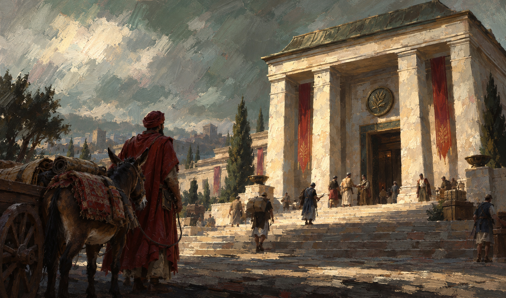
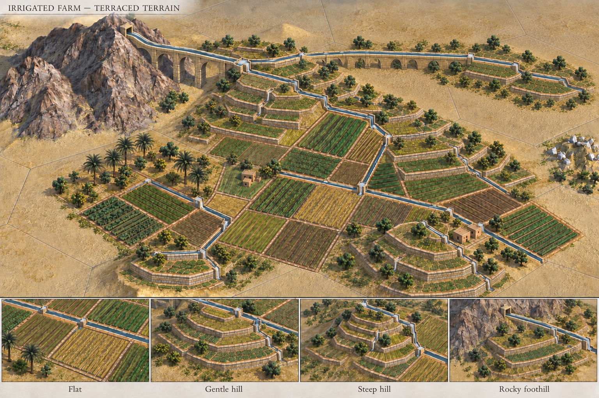
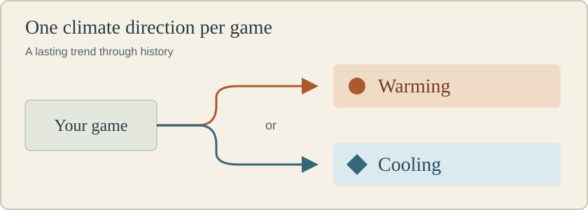

# AngelaDMerkel's Civilization V Mods

Custom mods by **AngelaDMerkel** for **Civilization V: Brave New World**.
Explore the projects below for a look at what each adds to your game, then follow
the guides for the goals, features and full rules of each mod.

**In development.** The current builds target new single-player games; in-game
testing is still pending. Images below are project artwork or diagrams.

## Realistic Terrain

*Ministry of Coin completion artwork included with the mod.*

Make the journey matter as much as the battle. Armies that spend too long in
desert, snow, tundra or jungle suffer exposure. Plan safe stopping points, use
freshwater for heat relief, and build roadside **Caravansaries** to shelter troops
beyond your borders.

The **Ministry of Coin** opens up your Caravansary network. Connect stations by
road, patrol the trade corridors, and use **Trade and logistics** to arrange
commercial agreements and compare Caravan, Motorized Caravan and Cargo Ship routes.

**Status:** experimental v2 build; includes Irrigated Farm.

**[Realistic Terrain guide](mods/realistic-terrain/docs/GUIDE.md)**

## Resource Outposts

*Approved Medieval outpost concept. The current build uses Civ V's Fort graphics.*

Secure distant iron, horses or luxuries without founding another city. Send a
worker to an unclaimed deposit and build a **Resource Outpost** to gain access to
its resources. Each site costs **2 gold per turn** and gives a defending unit a
**+50% defensive bonus**.

Manage your sites from one overview: locate a claim, abandon one you no longer
need, or convert it into a normal resource improvement after your borders expand.
Roads and garrisons are optional; an isolated claim still needs protection.

**Status:** experimental v1 build; works independently or alongside Realistic Terrain.

**[Resource Outposts guide](mods/resource-outposts/docs/GUIDE.md)**

## Irrigated Farm

*Approved farm and terrace concept. Current gameplay supports flat desert;
terraced hills and these custom graphics are still planned.*

Turn dry land into a connected farming network. At **Engineering**, build
**Irrigation Works**, then extend farms from rivers or nearby mountains, lakes
and oases. A supplied farm adds **+3 food** from its improvement; a disconnected
farm adds only **+1**.

Protect the links between fields. Pillaging one farm can cut off those farther
from the water, while repairing it or opening another connection restores supply.

**Status:** included with Realistic Terrain v2; no separate installation.

**[Irrigated Farm guide](mods/irrigated-farm/docs/GUIDE.md)**

## Climate Change

*Diagram of the planned climate direction; not a gameplay screenshot.*

A changing landscape could reshape the choices you made when settling your
empire. Climate Change is planned around one lasting direction per game:
**warming or cooling**. Natural change, industrial activity and city populations
will influence how conditions develop over time.

Terrain changes, pacing and player responses are still being designed.

**Status:** in planning; no playable build yet.

**[Climate Change guide](mods/climate-change/docs/GUIDE.md)**

## Getting started

Read the **[installation and compatibility guide](docs/GAMEPLAY.md#install-a-packaged-test-build)**
before starting a test game. Terrain and Outposts can be enabled separately or
together; Irrigated Farm currently comes with Terrain.

[All player guides](docs/GAMEPLAY.md) · [Development and contributions](docs/DEVELOPMENT.md)
