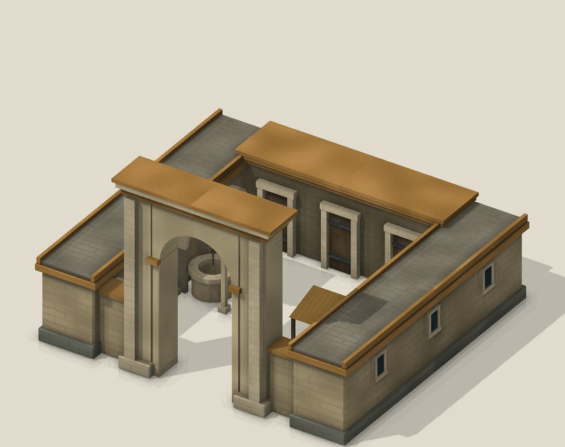

# Realistic Terrain: player guide

[Installation and mod selection](../../../docs/GAMEPLAY.md) ·
[Trade and logistics](TRADE-GUIDE.md) ·
[Irrigated farms](../../irrigated-farm/docs/GUIDE.md)

Realistic Terrain makes long expeditions depend on shelter and infrastructure.
Your army is safe at home, but repeated nights in harsh terrain weaken it.
Caravansaries provide relief along supplied roads, while a new trade planner makes
those roads and stations part of your economy.

This guide describes the experimental v2 build. Start a new single-player Brave
New World game; in-game testing is still pending.

## Start with these decisions

1. Watch the **Environment** panel when selecting a land military unit. End turns
   in friendly territory or near appropriate relief when possible.
2. Research **Horseback Riding** and build the **Ministry of Coin** if you want
   a network of Caravansaries.
3. At **Engineering**, send workers to build Caravansaries and connect them by
   intact roads to one of your cities.
4. Use **Trade and logistics** to arrange agreements, inspect routes and see what
   your infrastructure earns. Ordinary trade orders are replaced by this planner.

## Environmental exposure

Exposure is checked at the start of the unit owner's turn, using the tile where
the unit ended its previous turn. Crossing a desert during one turn does not
accumulate exposure if the unit finishes somewhere safe. Newly created units get
a full turn before their first check.

| Terrain | Grace period without support | Special rule |
| --- | ---: | --- |
| Desert | 2 turns | Suitable freshwater resets heat exposure |
| Tundra | 3 turns | Forested tundra adds only half a turn of exposure per check |
| Snow | 1 turn | Shares its cold exposure with tundra |
| Jungle | 4 turns | Jungle takes precedence over the terrain beneath it |

After the grace period, a unit suffers **−10% combat strength for two turns**.
Continued exposure increases this to **−20% combat strength and 5 damage per turn**.
Environmental damage stops at **25% of maximum health**; it does not heal a unit
that is already below that level. Only the strongest exposure combat penalty applies.

For example, an unsupported ordinary soldier in desert remains ready at its first
two checks, becomes strained at checks three and four, and becomes exhausted at
check five. Scouts and other sources of extra tolerance delay those stages.
Grace periods are the same at every game speed in this build.

### Relief and recovery

**Your territory and your team's territory** clear all exposure immediately,
including when the unit moves into them. A foreign army does not receive that
protection merely because it is inside your borders. Open Borders alone does not
make foreign land safe from exposure.

**Heat relief** comes from a riverside tile, flood plains, a lakeside tile, or
being on or adjacent to an accessible oasis. Salt water does not count. An enemy
occupying an oasis or lake source blocks its use. In peaceful foreign territory,
access to those sources requires Open Borders; uncontested enemy sources can be
used during war.

**Safe land** removes two points of accumulated exposure per turn. Heat, cold and
jungle exposure are tracked separately: an oasis clears heat, but does not instantly
cure jungle exhaustion. A badly affected unit can still suffer damage while recovering.

Embarking pauses exposure and its penalties. Landing restores any exposure the
unit was carrying. Lost health recovers through normal Civilization V healing;
clearing exposure does not restore health.

### Which units are affected?

| Unit or support | Effect |
| --- | --- |
| Land military units | Follow the exposure rules, including AI armies and city-state troops |
| Scouts and other recon-class combat units | Two extra grace turns for every hazard |
| Workers and other civilians, ships, aircraft, barbarians | Exempt from military exposure |
| Same-team Medic I or II on the tile or adjacent land | Two extra jungle grace turns; multiple medics do not stack |
| Engineering | One extra cold grace turn |
| Biology | One extra jungle grace turn |
| Penicillin | Two more jungle grace turns |

Embarked medics do not provide the jungle benefit. Trade units have their own
[route rules](TRADE-GUIDE.md), including infrastructure penalties.

## Ministry of Coin

The Ministry replaces the ordinary city Caravansary as a **national wonder**.
It is your empire's gateway to building roadside Caravansaries.

| Requirement or effect | Rule |
| --- | --- |
| Technology | Horseback Riding |
| Cost | 125 base production, increased by the national-wonder city-count adjustment |
| Limit | One per player |
| Maintenance | None |
| Origin-city trade benefits | +50% land trade range and +2 gold on international land routes from this city |
| Construction unlock | Allows workers to build Caravansaries once Engineering is known |

The trade benefits apply to the city containing the Ministry, not every city.
There is no prerequisite building to construct in every city. The Ministry cannot
be purchased or captured. Losing it prevents further Caravansary construction,
but does not switch off stations already completed.

*The Ministry's included completion painting. This is artwork, not a screenshot.*

## Caravansary: roadside shelter and trade support

A Caravansary is a **worker-built tile improvement**. Earlier notes may call it a
Relief Station; the current player-facing name is Caravansary. It is separate from
the city building replaced by the Ministry.

| Requirement or effect | Rule |
| --- | --- |
| Unlock | Engineering and a Ministry of Coin somewhere in your empire |
| Location | Valid land in your territory or unclaimed territory |
| Construction | Normal Fort work time, adjusted for worker and game speed |
| Upkeep | No station maintenance; connected roads and a military defender retain their ordinary costs |
| Connection | The station tile and the land path to one of your cities need intact roads or railroads |
| Military relief | Clears all exposure on the station and adjacent land tiles at the next turn check |
| Defense | No defensive bonus |
| Trade | Can extend range, provide relief and support patrols |

### Build and supply a station

1. Move an eligible worker to the chosen tile and cancel ordinary automation.
2. Choose **Build Caravansary** in the construction panel. Work continues on
   following turns; you do not need to click every turn.
3. Build a road on the station tile and connect it to any city you own. The city
   center itself does not need a separate road improvement.
4. End a military unit's turn on the supplied station or an adjacent land tile.
   Exposure clears at its next turn check. Passing through and leaving gives no reset.

Forest and jungle are preserved, subject to the normal Fort construction
requirements. Moving the worker, cancelling, or assigning a different job ends
the construction order. Loss of the Ministry pauses it; work and partial progress
survive saving and loading.

Supply can cross your land, neutral land and commercial-agreement partners' land.
Ordinary Open Borders is insufficient for commercial supply. An enemy on the
route, a pillaged road, a pillaged station or a gap in the road cuts that path.
An intact alternative path keeps supply working. Harbors and sea connections do
not supply these stations.

On neutral land, the builder owns the station. In claimed territory, the tile's
current owner controls it. Other armies cannot use your shelter; authorized partner
caravans can use your trade services. An ordinary Fort does not become a Caravansary.

*Preview of the approved custom model. It is not yet shown in the game; the current
build uses Fort graphics without the Fort's defensive bonus.*

### Patrol a trade corridor

Station a land combat unit at a supplied Caravansary for a full turn. It then
protects authorized caravans along connected road branches up to the next city or
Caravansary. Moving the defender resets activation; pillage or loss of supply
disables the patrol. This protection applies to trade routes, not ordinary workers
or other civilians travelling nearby.

## Farms and outposts

The included [Irrigated Farm feature](../../irrigated-farm/docs/GUIDE.md) lets you
grow connected farms across flat desert. Its Irrigation Works building does not
require a Ministry of Coin.

If you also enable [Resource Outposts](../../resource-outposts/docs/GUIDE.md),
an intact outpost clears exposure for its owner's military unit on that exact tile
at the next turn check. Outpost shelter needs no road connection, has no adjacent
radius and does not heal health. It is not a trade relay or patrol station.

## When something seems wrong

**The army is beside a Caravansary but still exposed.** Check station ownership,
pillage and the complete road connection, including the station tile. Wait for the
next owner-turn check; relief does not occur while passing through.

**A unit is still injured after reaching safety.** Shelter clears exposure and
combat penalties. Health follows ordinary healing rules.

**A worker cannot build a Caravansary.** Check Engineering, a living Ministry,
tile ownership, normal terrain/feature requirements and worker automation. The
station's road is a separate worker action.

**The trade unit disappeared when I started a route.** Active trade is tracked in
the planner. Use **Active routes** and **Locate**; see the [trade guide](TRADE-GUIDE.md).

[Back to player guides](../../../docs/GAMEPLAY.md)
