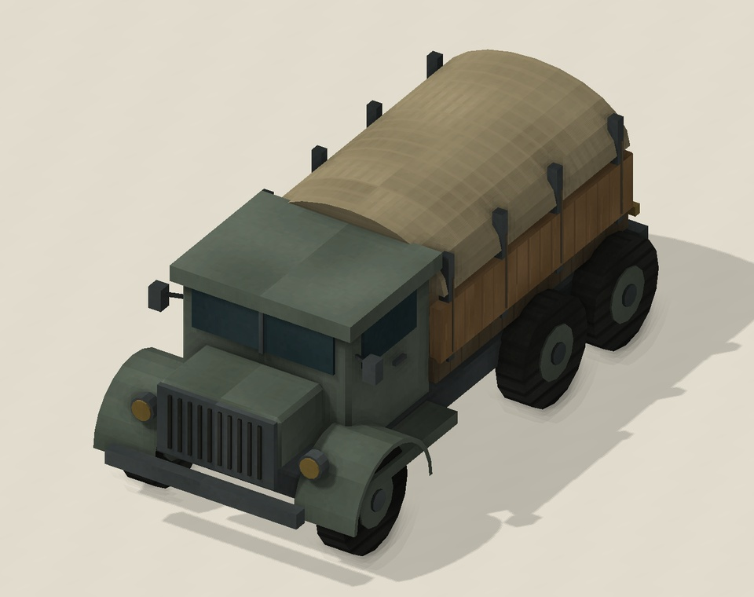

# Trade and logistics

[Realistic Terrain guide](GUIDE.md) · [Installation](../../../docs/GAMEPLAY.md)

Terrain v2 replaces ordinary trade orders with **Trade and logistics**, near the
upper right of the screen. Build commercial agreements, connect roads and stations,
then compare the extra income a route would add to your network.

Active routes appear in this planner rather than as animated units travelling on
the map. Your trade unit returns when the route finishes or is recalled; it is lost
if the route is destroyed. This experimental system has important
[differences from standard trade](#differences-from-standard-trade).

## Launch your first route

1. Train a **Caravan**, **Motorized Caravan** or **Cargo Ship**. Select it in one
   of your cities while it still has movement available.
2. Open **Trade and logistics → Agreements**. Sign an agreement with the foreign
   destination and any other civilization whose territory the route must cross.
3. Open **Plan routes**. Choose a revealed destination and read the route's
   eligibility, efficiency, patrol coverage and additional net income.
4. Choose **Establish**. You need a free trade-route slot. The selected unit is
   committed to the route until it ends.
5. Use **Active routes** to locate or recall it, and **Accounts** to inspect income.

Domestic food routes need a **Granary** at the origin (Pottery; 60 base production;
1 gold maintenance). Production routes need a **Workshop** (Metal Casting;
120 base production; 2 gold maintenance). Neither needs a foreign destination
agreement, but transit through somebody else's land still requires commercial access.

## Trade units

| Unit | Availability | What makes it useful |
| --- | --- | --- |
| Caravan | Animal Husbandry; 75 base production | The cheaper land trader for a developed route |
| Motorized Caravan | Combustion; 150 base production; no strategic resource required | Can cross roadless neutral land without Caravan Logistics and ignores environmental relief penalties |
| Cargo Ship | Sailing; 100 base production; coastal city required | Sea trade has no land-road or land-relief penalties; Astronomy is needed for ocean passage |

Researching Combustion does not replace existing Caravans or upgrade them
automatically. Both land units remain trainable. A completed or recalled route
returns the same type of unit that established it.

Land routes advance two tiles per turn; sea routes advance three. Roads improve
land **range**, not that route movement rate. Motorized Caravans are unarmed, and
their ability to ignore difficult terrain does not protect them from enemy raids.
Mountains, ice and water still block land routes.

*Approved custom model preview. The current build still uses ordinary Caravan
graphics; the truck is not yet an in-game model.*

## Agreements and access

Commercial agreements are reciprocal: both partners may trade and permit transit.
They are separate from military Open Borders. AI partners accept during peace
when there are no denunciations.

War ends agreements. Peace does not renew them automatically. Revocation, lost
access or a relevant city changing hands can recall affected routes. If a route
crosses a third civilization, an agreement with the destination alone is insufficient.

## Caravan Logistics and route range

**Caravan Logistics** is a Medieval technology following **Engineering**, with a
base research cost of 275. Before it, an ordinary Caravan needs roads through
neutral territory. The planner refuses a route that cannot meet that requirement.
If a road disappears after launch and the Caravan enters the newly roadless neutral
tile before the technology is researched, that route is destroyed.

After Caravan Logistics, ordinary Caravans can survive roadless neutral travel,
but still lose income when infrastructure or environmental relief is missing.
Motorized Caravans do not need this technology for roadless travel.

Range starts with the origin city's normal trade range and bonuses. The
**Ministry of Coin** increases land range from its own city by 50%. Each road
step costs half as much range as an ordinary land step. A reachable, supplied
Caravansary adds **five range**, up to **ten extra range per route**. The route must
be able to reach a station before using its extension; a distant disconnected
station cannot make an otherwise unreachable journey possible.

The planner can look for a route through suitable stations. Losing a station or
connection needed for range recalls the route.

## Roads, relief and income

For an **ordinary Caravan**, two conditions affect payment:

- A break in continuous roads causes a **40% reduction**.
- Harsh terrain without suitable relief causes another **40% reduction**.

The reductions add together: payment is 100%, 60% or 20%. Mild terrain does not
need relief. Home territory, cities, freshwater heat relief and nearby supplied
Caravansaries can provide the applicable protection. Ordinary Caravan domestic
cargo is also reduced by its route efficiency.

For a **Motorized Caravan**, environmental relief is unnecessary. Its gold instead
depends on continuous roads and an actual supplied Caravansary stop:

| Continuous roads | Supplied station on the route | Gold payment |
| --- | --- | ---: |
| Yes | Yes | 100% |
| Yes | No | 60% |
| No | Yes | 60% |
| No | No | 20% |

The motorized station stop must be on the route, intact, authorized, and connected
by road to its owner's city. An adjacent station or oasis is not a commercial stop.
One qualifying stop removes that reduction. The separate range benefit can use
up to two stations. Motorized **food and production deliveries remain at 100% cargo
efficiency**, even when roads or stations are missing.

For example, a motorized route with continuous roads but no supplied station earns
60% of its full gold payment. A qualifying station stop restores it to 100%.
Pillaging that stop drops it back to 60% until service is restored.

### Reading the income preview

**Additional net** shows what the new route adds after accounting for the existing
network. Use it to compare destinations; a longer journey is not automatically
the best investment.

Payments include commerce, a capped distance bonus, help with useful infrastructure
upkeep, and continuing income for roads and Caravansaries serving active routes.
Infrastructure shared by several routes is not charged repeatedly. Transit partners
can earn from useful infrastructure too. Extra traffic can increase that continuing
income, up to its cap.

These benefits continue while routes use the infrastructure; there is no one-time
payout for constructing and demolishing a station. Ordinary road and unit expenses
still apply. Some displayed expense allocations are estimates, so use **Accounts**
to understand the breakdown rather than treating every number as an exact cost for
one specific soldier.

Domestic routes deliver food or production instead of those commercial payments.
Their base delivery grows with era, is doubled for sea routes, and is then adjusted
by cargo efficiency. International routes can also provide science.

## Patrols, raids and route completion

A land combat unit stationed at a supplied Caravansary for a full turn protects
authorized caravans along connected road branches until the next city or station.
Moving that unit resets the patrol; pillage or loss of supply disables it.
Ordinary civilian units do not receive patrol immunity.

An enemy combat unit at an unprotected route position can destroy the route and
gain **100 gold**. The committed trader is lost. Motorized traders still need
protection, even though they tolerate harsh terrain.

Routes run for at least the normal deal duration for the chosen game speed,
then finish their current circuit. **Recall** returns the trader immediately
to its origin, or to your capital if the origin is lost. A destroyed route returns
no unit. The active-routes list also shows foreign traffic when it is visible to you.

## Differences from standard trade

Use **Accounts** for this system's trade income. The ordinary trade overview and
top-bar gold-per-turn forecast do not show these routes; income is paid to the
treasury on your turns.

Active routes have planner positions and **Locate** controls, but no animated
Caravan or Cargo Ship to select on the map. Raids are handled at those positions,
rather than through the normal plunder command.

The current build does **not** reproduce trade-related religious pressure, tourism
connections, World Congress embargo enforcement or trade-route quests. Some
civilization and policy interactions may differ from standard Brave New World.
Earlier alpha saves and existing native routes are not converted. Start a new game.

## Common problems

**Establish is disabled.** Check remaining movement, an idle trader in your own
city, a free trade slot, agreements, revealed destinations and the stated route
requirements. An identical route of the same cargo type cannot operate twice.

**The route lost income.** Look for broken roads, missing relief or—on a motorized
route—a lost station stop. Infrastructure is checked again as conditions change.

**A station did not extend range.** It must be supplied, accessible and reachable
before its bonus is used. Another player's city does not count as its owner's
road connection.

**Why does the AI still build ordinary Caravans?** They cost less. The AI can
prefer them when they can operate a route as efficiently as the motorized option.

[Back to Realistic Terrain](GUIDE.md) · [All player guides](../../../docs/GAMEPLAY.md)
