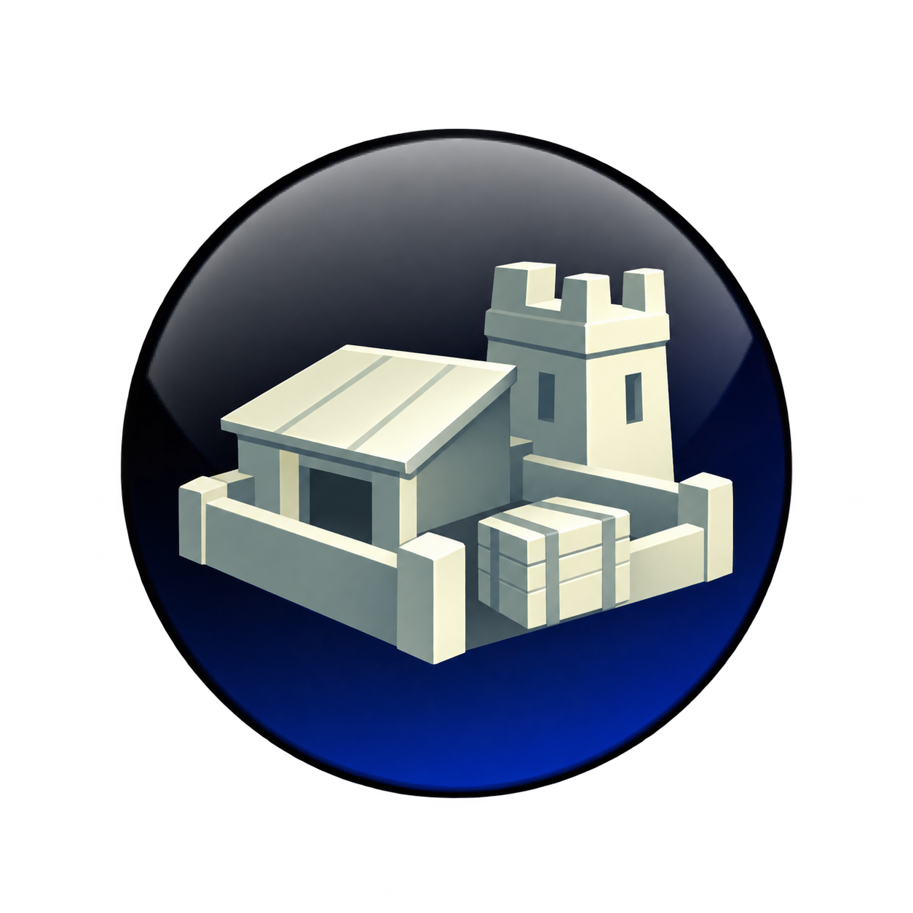
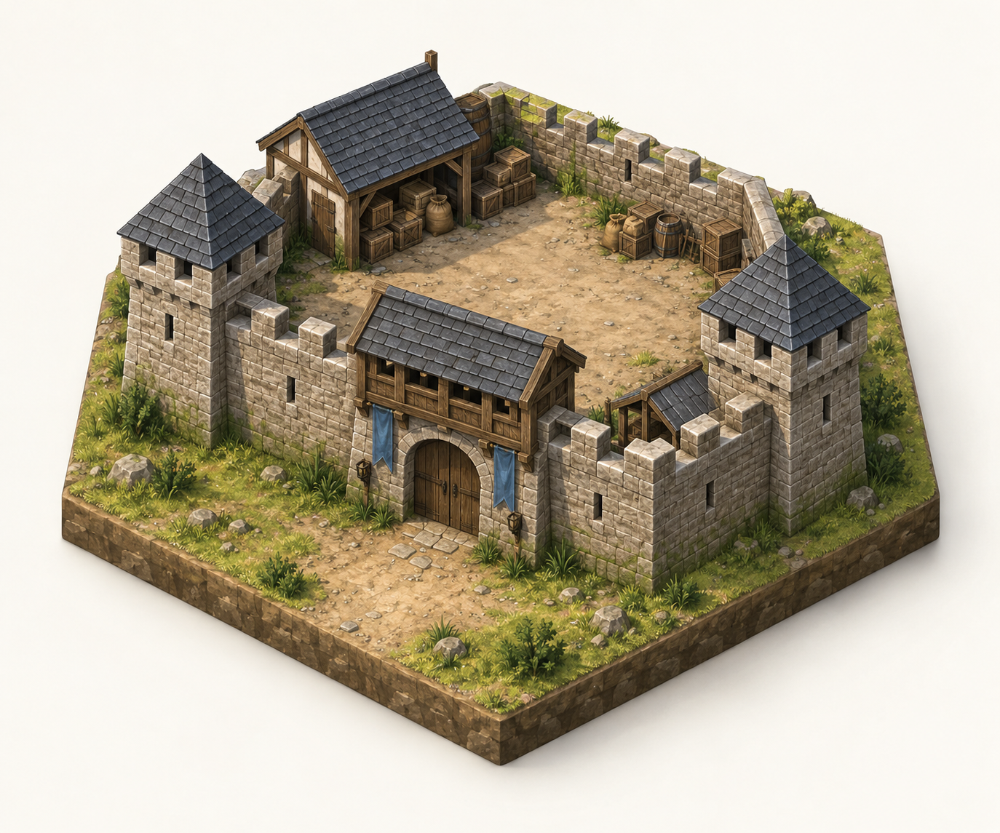

# Resource Outposts: player guide

[Installation and mod selection](../../../docs/GAMEPLAY.md) · [Mod introduction](../README.md)

A Resource Outpost claims a strategic or luxury deposit in neutral land without
founding a city or expanding your borders. It gives your empire access to that
resource, at the cost of upkeep and the risk of maintaining a remote position.

This guide describes the experimental v1 build for a new single-player Brave New
World game. In-game testing is still pending.

*The selected Guarded Storehouse emblem is included in the mod's portraits,
management controls and strategic-view marker. It is an icon, not a map model.*

## Build your first outpost

1. Research **Engineering**, reveal the resource, and research its normal
   extraction technology, such as Mining or Calendar.
2. Send a worker to an **unimproved strategic or luxury deposit on neutral land**.
   Consider sending a defender with it.
3. Select the worker and choose **Build Resource Outpost**. Construction uses the
   normal Fort work time, adjusted for worker and game speed.
4. Work continues on later turns. Once complete, the deposit supplies your empire.
5. Open **Resource Outposts** to locate the site, inspect its output or manage it.

Roads, supply connections, trade agreements and a Ministry of Coin are unnecessary.
A garrison is optional for extraction. Moving the worker, cancelling construction
or giving another job ends its assignment; partial progress and continuing orders
survive saving and loading.

## What you gain—and what it costs

| Feature | Rule |
| --- | --- |
| Eligible resources | Strategic resources and ordinary land luxuries |
| Resource access | The deposit's base quantity, available for ordinary use and trade |
| Base upkeep | 2 gold per turn for each standing outpost |
| Defense | +50% defensive bonus for a defending unit on the tile |
| Territory | No border expansion |
| Required units | A worker to construct it; an optional military defender |

Supported strategic resources include iron, horses, coal, oil, aluminum and uranium,
when their other requirements are met. Bonus resources such as wheat, artifacts,
and water deposits are excluded. The improvement does not clear forest, jungle
or marsh; normal construction prerequisites still apply.

An iron deposit containing six iron supplies six iron, not six more each turn.
A silk outpost supplies that luxury for normal happiness and trade purposes.
Outposts do not produce food or production for a city and do not satisfy buildings
that need a resource specifically near that city.

Upkeep appears under **building maintenance** and receives the usual maintenance
modifiers. A pillaged, blockaded or annexed outpost still costs upkeep. A defender's
ordinary unit upkeep is separate. If a site is no longer useful, abandonment can
stop its ongoing cost.

## Defending a remote claim

Move a land military unit onto the outpost and fortify it normally. The site is
an improvement, not a city: it has no city health bar, ranged bombardment or
city-garrison policy benefits.

Neutral land keeps its normal access rules. A peaceful foreign unit can enter an
undefended tile, and neutral improvements may be pillaged without a declaration
of war. Peaceful entry or repair does not transfer the claim. A military defender
helps enforce ordinary combat and stacking restrictions.

| Event | Result |
| --- | --- |
| Pillage | Resource access stops; the outpost remains and upkeep continues |
| Repair | Access resumes if the site's other requirements are met |
| Enemy land combat unit enters during war | The neutral outpost changes owner; the new owner needs the extraction technology |
| Barbarian interference | Resources can be blocked, but barbarians cannot own the claim |
| A civilization's borders absorb the tile | The territorial owner takes control of the site |

Capture does not repair a pillaged site. Notifications report resource access
lost or restored, capture and other ownership changes. If your own borders absorb
your outpost, you should retain access rather than receive the resource twice.

## Locate and manage your sites

The **Resource Outposts** button opens an overview of every site you own. It shows
the resource and quantity, extraction status, defender and health, and base upkeep.
Use **Locate** to center the map or **Manage** to inspect the site's options.
You do not need a selected unit or a stationed garrison to manage an outpost.

### Abandon an outpost

The management panel previews the resource access you would lose and the base
upkeep you would save. It warns if abandonment would remove your last available
copy of a luxury or leave you short of a strategic resource.

Abandonment requires confirmation. If the quoted effects change before you
confirm, review the new result. The action removes the outpost and its upkeep;
if the tile has already joined your borders, the tile remains yours. Check active
exports and unit requirements before giving up a resource you depend on.

### Convert after your borders expand

Once an intact outpost is inside your borders, **Convert improvement** can turn
it into the ordinary Mine, Quarry, Pasture, Camp, Plantation or Well for that
resource. You need the usual technologies and a legally buildable improvement.
Pillage or hostile occupation blocks conversion.

Conversion keeps resource access and ends outpost upkeep, but removes the **+50%
fort defense**. It applies the ordinary improvement's feature-clearing effects.
The management panel explains the change before confirmation. Keep the outpost
if its defensive position is worth the cost; convert it if you prefer an ordinary
resource improvement.

## Playing alongside Realistic Terrain

Outposts work independently. If **Realistic Terrain v2** is also enabled, an intact
outpost shelters its owner's military unit on that exact tile. Exposure and its
combat penalties clear at the next owner-turn check; health does not heal instantly.

Shelter has no adjacent radius and stops when the outpost is pillaged. It still
needs no road or city connection. Outposts do not become Caravansary trade relays
or road-patrol stations.

## What the AI does

AI civilizations prioritize repairs and resources they lack. They can send workers
with escorts, station guards and replace wounded defenders. Their number of
planned sites depends on the economy and available troops. They keep a worker for
domestic work and use a limited number for nearby expeditions.

Those planning limits do not cap human outposts. Each additional site still
brings its own upkeep and defense needs. Overseas expeditions are outside the
current AI's scope, and long-game behavior still needs playtesting.

## Appearance

*Approved Medieval concept for future map graphics. The current playable package
uses Civ V's Fort models. Automatic era changes and the custom structures shown
here are not yet in the game.*

## Common questions

**Why can't I build on this resource?** Check that it is revealed, on neutral
land, unimproved, and a supported strategic or luxury deposit. You need Engineering
and its normal extraction technology. An already improved or owned tile is not a
new neutral outpost site.

**Why am I paying for a pillaged outpost?** A standing claim still incurs upkeep.
Repair it to restore access or abandon it to stop the expense.

**Why did I lose the deposit when borders reached it?** Territorial ownership
takes precedence over a neutral claim. The civilization owning the tile receives
the site; maintaining an outpost does not reserve that territory permanently.

**Can I build one without a road or defender?** Yes. Neither is required for
construction or extraction, but an unguarded neutral site is easier to disrupt.

[Back to player guides](../../../docs/GAMEPLAY.md)
