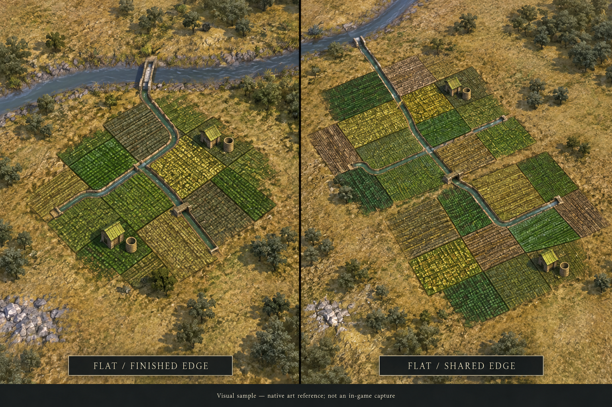
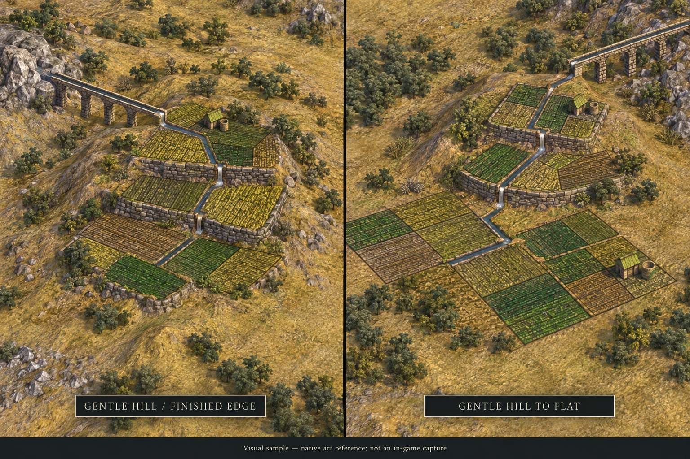
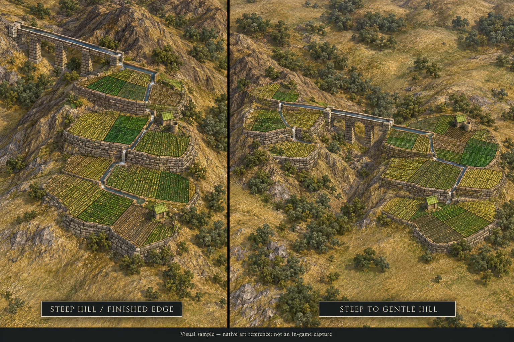
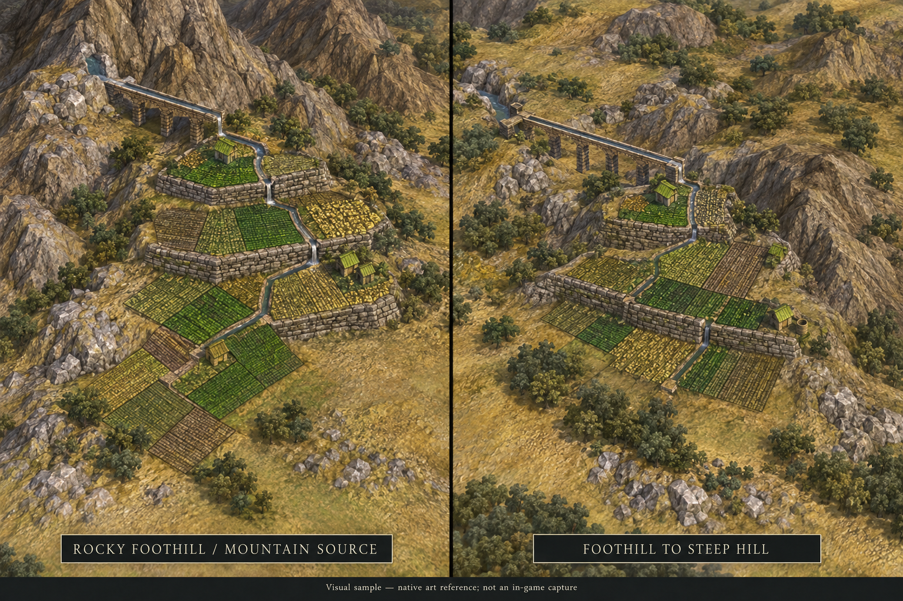

# Channels between native farm plots

These four terrain samples refine the selected native-farm approach: irrigation
runs through a few existing inter-plot paths, while most plot boundaries stay dry.
The established terrain families are flat ground, gentle hills, steep hills and
rocky foothills. Each sheet includes a finished boundary or mountain source and
a connected arrangement. This covers eight illustrative views, not every possible
neighbor mask or biome.

Generated with the built-in imagegen tool using the preferred study and actual
Civ V screenshots/terrace texture as references. These are visual samples for
review, not exact native texture edits, mesh renders or in-game captures.
No gameplay, mesh geometry or existing approval records changed. Native UV
alignment and hydraulic/terrain clearance still require source and game checks.

The selection of this overall approach is recorded in
[direction-selection.json](../native-overlay-study/direction-selection.json).
Exact prompts, source/reference roles and image hashes are retained here.

| Terrain | Left view | Right view | Exact prompt |
| --- | --- | --- | --- |
| [Flat ground](flat.png) | flat farm with finished exposed edges | flat-to-flat shared connection | [Prompt](flat-prompt.txt) |
| [Gentle hill](gentle-hill.png) | gentle hill with finished exposed edges | gentle-hill-to-flat transition | [Prompt](gentle-hill-prompt.txt) |
| [Steep hill](steep-hill.png) | steep hill with finished exposed edges | steep-to-gentle-hill transition | [Prompt](steep-hill-prompt.txt) |
| [Rocky foothill](rocky-foothill.png) | mountain-source-to-rocky-foothill intake | foothill-to-steep-hill transition | [Prompt](rocky-foothill-prompt.txt) |

Native reference pages: [ordinary Farm](https://store.steampowered.com/app/99614/)
and [Incan Terrace Farm](https://steamcommunity.com/sharedfiles/filedetails/?id=157241384).
Native reference extracts are not included with the source images.

## Flat ground

## Gentle hill

## Steep hill

## Rocky foothill

